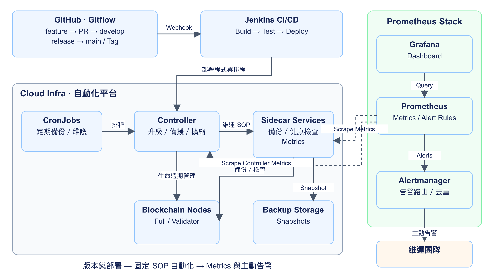
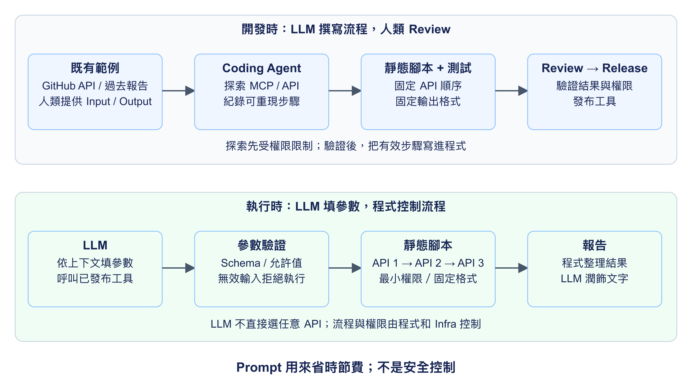
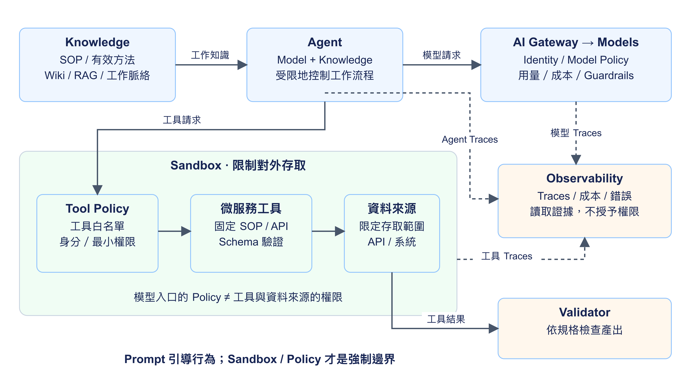
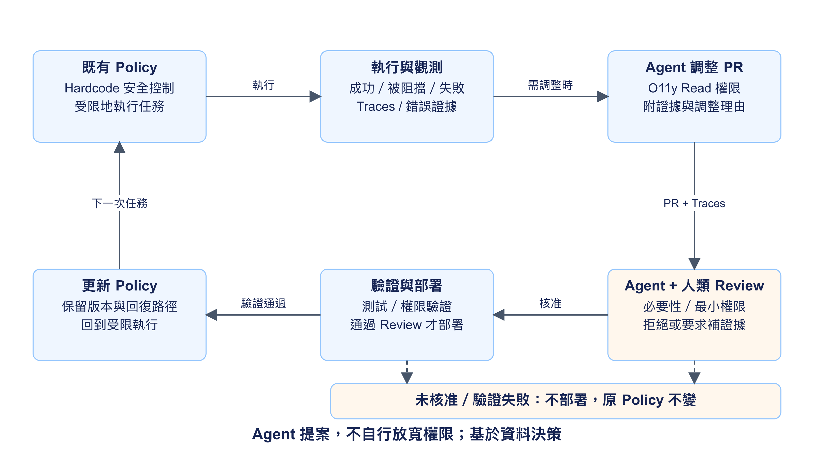

##### Platform Engineering 的 AI 落地案例

Che-Chia Chang

---

「AI 真的能實際落地在我的工作流程嗎？」

---

以我自身經驗分享三個實務專案

- 從自動化大平台、到微服務 到 Agents Platform
- 需求、開發步驟與落地成果

---



---

##### Outline

- Project 1: 已知流程自動化
- Project 2: 微服務與工具箱
- Project 3: Agents
- Takeaways

---

##### Project 1
##### 已知流程自動化

將固定的流程自動化

---

##### 自動化

需求：Blockchain Full / Validator Node
- 已有流程完整，有固定 SOP，規格清楚
   但操作耗時
- 步驟繁瑣，低成就感，人工容易出錯
- 背景：從早期自動化到開始使用 ChatGPT
- GPT-3.5（2022/11） GPT-4（2023/03）

{}
至少要知道服務劣化
{}

---

##### 自動化｜步驟

- 人工設計流程、架構圖與開發階段
- LLM 協作開發，產生程式碼與測試
- Prompt Engineering + Spec-kit
   參考既有的 [SDD Workshop](../../posts/2026-07-01-ws-speckit-ai-ent/)
- QA 手動測試，部分自動化測試

---

##### 自動化｜成果：大平台

- 單一程式碼的平台 基於 Cloud Infra 實作 Controller 與 Sidecar Services
- 自動化升級、維護、備份與備援
   支援水平與垂直拓展
   高可用
- 整合 Prometheus Metrics 與 Alertmanager 主動告警
- 大幅降低維運時間，提升團隊幸福度

---

##### 自動化｜平台架構

{}
架構示意：GitHub 管理版本，Jenkins 自動測試與部署；PR 驗證與正式 Release 部署依分支／Tag 分流
CronJobs 觸發固定 SOP，Controller 與 Sidecar 執行節點維運
Prometheus 主動抓取 Metrics，Grafana 查詢展示，Alertmanager 通知維運團隊
{}

---

##### 自動化｜後來的問題

- 需要持續支援新鏈，平台未必通用
   規格變化需要增加 code
- 大平台開發與驗證成本增加
- 平台架構增加一定複雜度，增加除錯的成本

{}
比起工讀生，程式架構變得複雜
{}

---

##### 自動化｜後來的問題，交給後來的模型解決

- 大方向與架構沒有改動
- 支援新鏈，對 LLM 而言
   持續增加新功能的成本很低
- 複雜度帶來除錯的成本
   將 SOP 寫成 Skills／Scripts
   降低 Token 成本
- 給予 LLM O11y 可讀權限，加快除錯

---

##### 小結｜已知流程自動化

- 選對題目比努力重要，跟畢業論文一樣
- 固定規格的流程才適合追求 100% 自動化
   高人工成本，規格固定
   低風險，被依賴性低
- 選好題目，追求自動化，享受成果
   直到需求改變的那天

{}
{}

---

##### Project 2
##### 微服務工具箱

整理模糊的流程，固定工具

---

##### 微服務｜需求：跨平台系統稽核軌跡

- 所有系統操作都要有 Audit Log
   並產出報告
- 抽查特定系統，保留定期抽查紀錄
- 自動化持續檢測與告警
- 流程大方向穩定，但細節模糊
- 輸入不同來源，輸出格式發散

---

##### 微服務｜步驟：標準化流程

- 從粗略的流程開始讓 LLM 探索
   以 GitHub Audit 為例
   固定 Input：GitHub API
   固定 Output：提供過去的報告供 Agent 閱讀
   Coding Agent 猜測作法
- LLM 會嘗試不同的 MCP 與 API呼叫
- 紀錄 LLM 完成步驟，產出靜態腳本
   將步驟標準化，細節逐漸收斂

---

##### 微服務｜問題：LLM 呼叫的風險

- 給 LLM 一個 Goal
   LLM 會嘗試各種 MCP 與 API 呼叫
- 檢查 Guardrails 與 Observability
   發現破壞性操作
   或是呼叫不安全的 API
- System Instruction 不能確保安全
   例如允許 curl，但跟他說不要 Call Credentials API
   某天還是在 AWS EC2 上呼叫 Credentials API

{}
跟人有點像，跟你說不要做，就反而點醒你
喔原來還有這招啊我本來都沒想到
{}

---

##### 微服務｜LLM 呼叫的風險

- 移除探索步驟
   不讓 LLM 過度嘗試
- 「允許呼叫這些 API」改為固定流程
   「依序呼叫 API 1、2、3，並整理結果」
- Hardcode 控制流程

---

##### 微服務｜靜態腳本控制流程

- 使用腳本程式碼控制流程
   「依序呼叫 API 1、2、3，並整理結果」
   LLM 只能呼叫程式，依上下文填參數
- 補強資料來源安全性控管
   對可完整控管的來源（如 GitHub）設定最小權限
   對權限控管不足的來源，建立微服務提供 API
- 移除容器中用不到的工具

---

##### 微服務｜從探索到固定流程

{}
流程示意：開發時，先限制權限，再讓 Coding Agent 探索；把有效步驟寫成可測試的工具
執行時，LLM 只填參數，工具驗證輸入並依固定順序呼叫 API，最後潤飾結果
Schema 驗證不等於授權；仍需 Infra Policy 與最小權限
{}

---

##### 微服務｜成果：微服務工具箱

- LLM 從「執行流程」變成「撰寫流程」
- 程式碼控制流程，容器限制工具
   Infra Policy 控制權限
   prompt 用來省時節費
- LLM 潤飾結果與產出格式
- Input/Output 相當程度的變動
   LLM 依然能產出報告
- 以微服務小工具取代大平台

{}
prompt 用來省時節費，外部權限鎖住，LLM prompt 告訴他鎖住了，降低浪費 tokens 嘗試的機會

以微服務小工具取代大平台，是因為使用情境的決定
不是因為 LLM 所以大平台比較不好，微服務比較好
微服務整體架構複雜，但比較有彈性
{}

---

##### 微服務｜心得：從大平台到小工具

- 確保基本權限安全，再讓 LLM 探索
- 微服務小工具更好開發與驗證
- LLM 從「執行流程」變成「撰寫流程」
   能用選擇題，就不要讓 LLM 申論題
   選擇題又快又安全，Decision Model

{}
Decision Model：限定結構化選項，不接受自由格式指令
{}

---

##### Project 3
##### Agents

---

##### Agents｜需求：自動化開發

- Jira → PR → Review → Release
- 降低需要人類介入的環節
- 把專注力用在 Review 與驗證

---

##### Agents｜步驟：提供基礎知識

Traces 發現 Agent 嘗試很多無效方法
- 提供可追溯的工作脈絡
   內部專有知識/SOP/過去重複工作
- Knowledge Base/LLM Wiki/RAG
- 紀錄無效的方法，給人類參考
   不給 Agent Negative Prompt 不一定有用 
- 紀錄有效的方法，輸入 Agent prompt

Agent = Model + Knowledge

{}
Decision Model：限定結構化選項，不接受自由格式指令
{}

---

##### Agents｜提供存取限制與成本控管

- AI Gateway 統一模型入口 集中控管 Policy 與用量
   配置不同 Guardrails 的[虛擬模型](https://agentgateway.dev/docs/standalone/latest/documentation/llm/virtual-models/)
- Observability 收集 Traces、成本與錯誤
   沒有 O11y 就沒有品質控管
- Auth 確認使用者(Agents)身分；Policy 限制資料與 Tools
- 請見 [AI Gateway：AI 治理的第一步](../../slides/2026-10-15-hwdc-ai-gateway)

Agent = Model + Knowledge + Cost Mgmt

{}
Cost Management
{}

---

##### Agents｜提供安全控管

Traces 發現 Agent 嘗試危險方法被阻擋
- Prompt 要求流程控制
   指定使用安全的工具
- Sandboxing：限制對外存取
- Guardrails：過濾 LLM 產出
- Validator：Agent 自己依規格檢查產出

Agent = Model + Knowledge + Cost  + Security

{}
基於 Security Policy 架構，讓 LLM 打造小工具非常快速
基於安全的工具讓 Agent 控制流程
{}

---

##### Agents｜控管架構

{}
架構示意：把模型請求與工具請求分開看，AI Gateway 的模型 Policy 不取代資料來源權限
Sandbox 限制對外存取，Tool Policy 與微服務控制允許的操作
Observability 收集證據；Validator 檢查結果，不取代安全邊界，也不保證結果正確
{}

---

##### Agents｜安全控管 Feedback Loop

- 產出 Hardcode 安全控制基礎 人類 Agent 協作產生第一版
- Agent 做不出來會回報
   給 O11y Read 權限除錯
   Agent 自己發調整 PR 給人類
   PR 附上 O11y 結果，判斷是否需要調整
   基於資料決策，不能隨便改 Policy PR
- 產生一個 Policy Review Loop
   Agent 建議調整 Policy
   其他 Agent + 人類 Review

{}
做很多 Sandboxing 或是 Policy 控制，會不會影響 Agent 的效能？維護是否會麻煩？

PR 附上 O11y 結果，判斷是否需要調整
可能是偶然或是特例工作
基於資料決策，不能隨便改 Policy PR
{}

---

##### Agents｜Policy Review Loop

{}
流程示意：Agent 被阻擋或做不出來，先讀取 Traces，判斷是工具問題、特例，還是確實需要改 Policy
PR 必須附證據，由其他 Agent 與人類 Review；核准並通過驗證後才部署
未核准或驗證失敗，不部署，原 Policy 不變；Agent 不能自行放寬權限
{}

---

##### Agents｜成果

- FAQ Agent：回覆重複問題
   作為團隊第一個 Agent，風險低效益高
- Orchestration Agent、Coding Agent
   PR Review Agent、Debug Agent
- Validator：依規格檢查產出

---

##### Agents｜後續與心得

- 微服務提供資料基礎與工具
    Agent 控制流程
- Security First 才走得遠
   安全控制要 Hardcode
   或是選用有 sandboxing 的解決方案
   Security Prompt 不是安全控制
   prompt 用來省時節費，僅供參考
- 不讓 Agent 用超出你想像的方式做事

{}
看起來諸多限制，但實際上跑的很好
不要讓 Agent 用超出你想像的方式做事
{}

---

##### Takeaways

- 平台工程做的事都一樣，AI 只是加速手段
- 挑對題目
- 流程與安全需要 Hardcode
- 從小工具開始堆疊平台
- 安全第一

---

##### Q&A

---

##### Q&A
如何開始 AI + Platform Engineering？

{}
- 找題目: 現在痛點，流程與需求大方向穩定，依賴性低，低風險
- 自動化: 先不求 AI，先把流程自動化
    AI 只是幫助實現自動化
{}
